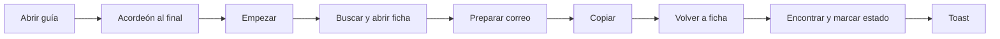
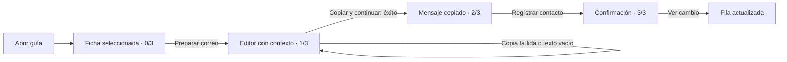

# Recorrido guiado de CicloServicio
Base: codex/cola-operativa-producto, commit 04135d57c6e0569b71c4459d93bfd242d14b41b2.

## Traza anterior y pérdida de contexto
1. El enlace demo.html?guia=1 cargaba guideState con cuatro booleanos en false.
2. La inicialización abría quick-guide y desplazaba al final del dashboard.
3. startGuide exigía otro clic: aplicaba el filtro pending y enfocaba una fila, sin abrirla.
4. render actualizaba la lista y un progreso separado de la acción.
5. openClient marcaba priorities y opened a la vez; una interacción completaba dos pasos.
6. draft-button marcaba drafted y cambiaba de diálogo; no conservaba ediciones al regenerar.
7. copy-draft solo mostraba “Copiado.”: no avanzaba ni contaba la copia.
8. return-client obligaba a volver a la ficha y encontrar el cambio de estado.
9. saveStatus marcaba updated y guardaba estados, pero no verificaba que se hubiera copiado.
10. La confirmación era un toast transitorio; la guía quedaba lejos del contexto.

## Diagramas




## Decisiones y fuentes
- [Driver.js, ejemplos](https://driverjs.com/docs/examples), [configuración](https://driverjs.com/docs/configuration), [recorridos por acciones](https://driverjs.com/docs/interactive-tours) y [repositorio](https://github.com/nilbuild/driver.js): se adoptan acción actual, progreso, salida y transición después de un resultado asíncrono. No se incorpora la librería. Todo el flujo sucede dentro de diálogos nativos; indicaciones propias mantienen contenido y foco en la misma capa, sin posicionar popovers externos. No se afirma haber detectado un fallo concreto de Driver.js: es una decisión de complejidad y composición.
- [NN/g](https://www.nngroup.com/articles/onboarding-tutorials/): ayuda junto al trabajo, divulgación progresiva y salida/reinicio disponibles; no memorizar un tutorial antes de actuar.
- [WAI-ARIA APG](https://www.w3.org/WAI/ARIA/apg/patterns/dialog-modal/): foco inicial en encabezado, ciclo de Tab/Shift+Tab, Escape, cierre visible y retorno al contexto. Se añadió cierre de ciclo explícito después de observar salida hacia el navegador con el comportamiento nativo.
- [Humanamente](https://github.com/vicentealvarezasencio/humanamente): únicamente microcopy nuevo, con instrucciones concretas y sin promesas.

## Flujo implementado
La guía selecciona el primer caso pendiente y abre su ficha sin escribir estados ni completar pasos. Si todos los casos tienen un estado previo, permite repetir uno y lo advierte sin restablecerlo. Hay tres acciones reales: preparar, copiar con éxito, registrar contacto.

La copia correcta muestra el siguiente control dentro del mismo diálogo. Volver al borrador conserva el texto y exige copiar nuevamente. La guía no admite registrar contacto antes de copiar. Una copia rechazada, vacía o que termina después de salir no completa el paso. No se afirma un envío de correo.

Salir por el enlace, X, Escape o fondo cierra la guía y restaura los filtros de exploración. Los estados existentes se conservan. Al finalizar, la confirmación distingue guardado local y fallo de almacenamiento. La URL deja de pedir guía; recargar no reinicia un recorrido terminado. Se puede iniciar otra vez desde “Probar guía” o “Iniciar recorrido”.

demo.html permanece libre. El iframe y vista=landing no autoinician recorridos, incluso si reciben guia=1. La landing conserva todo su copy comercial.

## Lista exacta de textos modificados o añadidos

### Landing
Únicamente:
- Añadido: “Vista previa del producto · Exploración libre. El recorrido guiado se abre fuera de esta vista.”
- title accesible del iframe: “Demo interactiva de CicloServicio con datos ficticios” → “Vista previa del producto, sin recorrido guiado”.
Todos los encabezados, párrafos y CTA comerciales de la base permanecen literalmente iguales, incluidas las frases aprobadas. Una prueba reconstruye el archivo sin estas dos adiciones y su CSS, y compara su hash de blob con el original.

### Demo: sustituciones
- “Empezar con un pendiente” → “Iniciar recorrido”.
- “0 de 4 pasos” y el progreso “{n} de 4 pasos” → “{n} de 3 acciones completadas”, visible solo durante la guía.
- “Recorrido completo: el panel refleja el nuevo estado.” → “Recorrido completado: contacto registrado.”
- “Copiar mensaje” se conserva en modo libre; durante la guía es “Copiar y continuar”.
- Se elimina la lista introductoria: “Elige un seguimiento” / “Revisa la fecha clave.”; “Abre la ficha” / “Revisa servicio, fecha y motivo.”; “Prepara un correo” / “Edita el borrador.”; “Registra el resultado” / “El cambio se verá en el panel.”
- Se conserva el título “Prueba cómo se sigue cada mantención.” y el microcopy normal restante.

### Demo: textos nuevos
- “Probar guía”
- “Abre un caso de ejemplo con ayuda junto a cada acción.”
- “Salir de la guía”
- “Paso 1 de 3 · Revisar y preparar”
- “Revisa el servicio y las fechas. Luego pulsa «Preparar correo».”
- “Este caso conserva un estado anterior. La guía no lo restablece.”
- “Paso 2 de 3 · Editar y copiar”
- “Ajusta el mensaje si lo necesitas. Pulsa «Copiar y continuar».”
- “Mensaje copiado”
- “Registra el contacto”
- “El texto quedó en tu portapapeles. En este ejemplo, marca el seguimiento como contactado para completar el recorrido.”
- “La demo no envió ningún correo.”
- “Paso 3 de 3 · Registrar el contacto”
- “Pulsa «Registrar contacto» para actualizar el panel.”
- “Registrar contacto”
- “Volver al borrador”
- “Recorrido completado · 3 de 3”
- “Cerrar confirmación” (nombre accesible)
- “Seguimiento completado”
- “Copiaste el mensaje y registraste el contacto ficticio.”
- “El estado queda guardado en este navegador.”
- “El cambio queda solo en esta sesión: el navegador no permitió guardarlo.”
- “No se envió ningún correo. Puedes seguir explorando la demo.”
- “Ver cambio en el panel”
- “Guía cerrada. Los estados guardados se conservan.”
- “Escribe un mensaje antes de copiar.”
- “El texto cambió durante la copia. Vuelve a copiar la versión actual.”
- “No se pudo copiar. Reintenta «Copiar y continuar» o sal de la guía para copiar manualmente. No se avanzó de paso.”
- Contexto dinámico del editor: “{cliente} · {servicio}”; cliente seleccionado en copia y confirmación. Usa únicamente los datos ficticios existentes.

## Validación
Ejecutar sin instalar paquetes:
```sh
node tests/guided-flow.test.cjs
```
PASS: transiciones, prohibición de saltarse copia, copia vacía/rechazada, fallo de almacenamiento, salida durante copia asíncrona, repetición sin restablecimiento, todos los casos ya contactados, exclusión del iframe, edición conservada, modo libre, estados, restablecimiento y protección literal de la landing. Usa un DOM de prueba: no sustituye la validación real del navegador.

Pruebas reales en Chromium:
- 390 × 844 y 1440 × 1000: entrada directa, tres acciones, confirmación y fila actualizada; foco inicial y capturas por paso.
- Edición y texto del portapapeles contrastados; estado contactado conservado tras recargar.
- Tab/Shift+Tab dentro de la ficha; Escape devuelve foco al botón de entrada.
- Volver a ficha y editor mantiene el texto editado.
- Salir después de copiar conserva cinco pendientes; salir no escribe estados.
- Modo libre: búsqueda, vacío, estados, agendado y salida sin perder cambios.
- Filtros: todos 8; vencidas 1; sin contactar 5; visitas 4; renovaciones 5.
- 390 × 600: acción de copia termina en y=536, cierre en y=54; ambos visibles, sin desborde.
- En los cuatro momentos y ambos anchos: scrollWidth del diálogo igual a clientWidth; controles principales dentro del viewport.
- Landing → guía abre ficha directamente; iframe sin diálogo abierto ni botón de guía visible.
- Sintaxis JS, IDs, anclas internas, SVG y ausencia de emojis comprobados.

Límites: no prueba con usuarios nuevos reales, Safari/Firefox, lector de pantalla ni teclado virtual de un teléfono físico. La comprensión sin ayuda externa es una hipótesis pendiente de prueba de usabilidad, aunque el flujo funcional ya no requiere buscar controles. Durante una navegación de la sesión apareció un error MutationObserver sin URL, también observado en la auditoría anterior; el proyecto no utiliza esa API y su origen no está confirmado. No bloqueó el recorrido. No se afirma consola globalmente limpia.

No se envió correo, no se conectó backend ni se desplegó.
